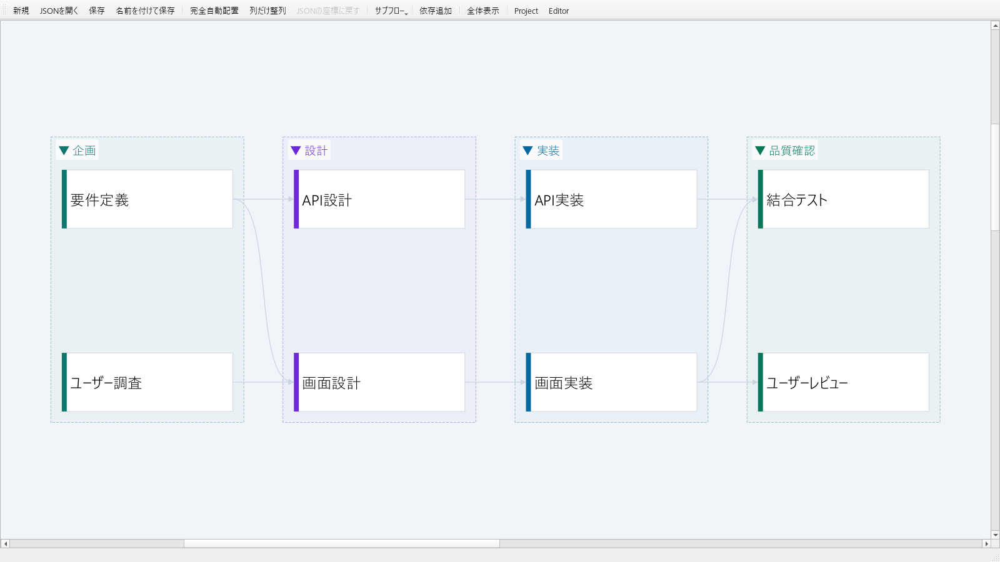
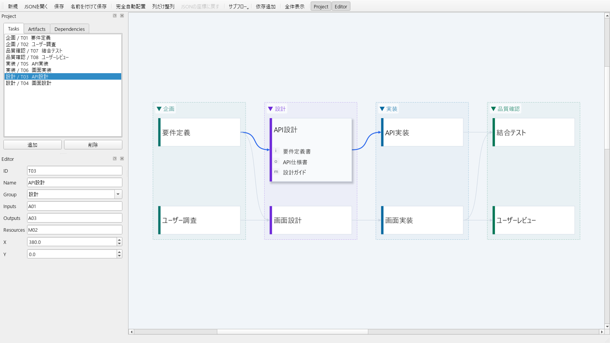

# pyTaskFlow

pyTaskFlow は、タスクの順序や成果物とのつながりを、見やすい図にして編集できるデスクトップアプリです。タスクを追加し、依存関係をつないで、プロジェクトの流れを整理できます。



タスクをクリックすると、関連する入力・出力・資料を確認できます。



## できること

- タスクとタスク間の依存関係を図で確認・編集
- タスク、成果物、参考資料を追加・編集
- 関連するファイルやWebページへのリンクを登録して開く
- タスクをドラッグして配置し、依存関係に合わせて自動整列
- グループごとにタスクをまとめて表示
- プロジェクトを保存して、あとから再開

## はじめかた

Windows と Linux で利用できます。Python 3.10 以上が必要です。

### Windows

1. `setup.bat` をダブルクリックし、セットアップが完了するまで待ちます。
2. `pyTaskFlow.vbs` をダブルクリックして起動します。

### Linux

次のコマンドでセットアップします。

```bash
chmod +x setup.sh pyTaskFlow.sh
./setup.sh
```

セットアップ完了後は、次のコマンドで起動できます。

```bash
./pyTaskFlow.sh
```

## 基本操作

### プロジェクトを開く・保存する

- `JSONを開く`: 保存済みのプロジェクトを開きます。
- `新規`: 空のプロジェクトを作成します。
- `保存`: 現在のプロジェクトを保存します。
- `名前を付けて保存`: 別の名前や場所に保存します。

編集内容を残すには、作業後に `保存` または `名前を付けて保存` を実行してください。元のファイルを残したい場合は、`名前を付けて保存` で別ファイルを作成できます。

### タスクや成果物を編集する

左側の `Tasks` または `Artifacts` タブで項目を選び、追加・削除します。選択した項目の情報は `Editor` ペインで編集します。タスク ID は追加時に自動で設定されます。

タスクにグループ名を設定すると、図の中でグループごとにまとめて表示できます。成果物にはファイル、フォルダー、Webページなどのリンクを登録できます。

### 依存関係を編集する

1. `依存追加` を選びます。
2. 先に実行するタスク、次にその後に実行するタスクの順でクリックします。
3. 依存関係を解除するには、接続線を右クリックして解除します。

`Dependencies` タブでは依存関係を一覧できます。一覧から項目を選ぶと、図の対応する接続線が強調表示されます。

### 図を見やすくする

- タスクをドラッグすると、図の中で位置を調整できます。
- `完全自動配置` は依存関係に合わせて全体を並べ直します。
- `列だけ整列` は列の位置を整え、上下の配置を保ちます。
- `全体表示` は図全体が画面に収まるように表示します。
- `Ctrl` キーを押しながらマウスホイールを回すと、拡大・縮小できます。
- 図の空白部分をドラッグすると、表示範囲を移動できます。
- タスクをクリックして選択し、もう一度クリックすると、関連する入力・出力・資料の表示を開閉できます。
- グループ名をクリックすると、グループを折りたたんだり展開したりできます。

## ファイルについて

プロジェクトは JSON ファイルとして保存されます。大切なプロジェクトは、定期的に別の場所にもコピーしてバックアップしてください。

## ライセンス

pyTaskFlow 本体は [MIT License](LICENSE) で提供されます。PySide6 / Qt およびその他のライブラリのライセンス情報は [THIRD_PARTY_LICENSES.md](THIRD_PARTY_LICENSES.md) をご確認ください。
